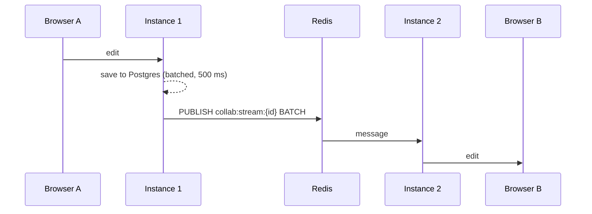

# 0004 · Redis pub/sub between API instances

- **Status:** accepted
- **Date:** 2026-10-11

## Context

An open document lives in memory, in one room per instance (ADR 0012). With more than one API
instance behind a load balancer, two people editing the same document can be connected to
different instances, and each instance's room has to learn what the other's clients type, who is
where (cursors), and events such as "your access was removed" or "the comments changed".

Production runs one instance (Render's free tier), so this is proved locally: two instances
behind nginx in Docker Compose, real browsers, a k6 load test, and tests that run two apps in one
process. Nothing here may slow down the single-instance case.

## Decision

**Redis pub/sub, one channel per open stream.** A stream is a document's main text or one of its
branches. Every instance holding a stream's room subscribes to `collab:stream:{id}` while the room
is in memory. A second channel, `collab:control`, which every instance always subscribes to,
carries events about a whole document (kicks after an access change, trashing).

**Messages are binary:** a version byte, the sender's instance id (16 bytes), a kind, and a
payload. An instance ignores its own messages, which Redis echoes back, and ignores versions and
kinds it does not know, so two releases can run side by side during a deploy.

| Kind | Channel | Meaning |
| --- | --- | --- |
| `BATCH` | stream | One merged Yjs update and the latest state of each changed cursor |
| `HELLO` | stream | "My subscription just became active; here is my state vector" |
| `DIFF` | stream | To one instance: the updates it lacks |
| `NEEDS` | stream | To one instance: "send me what I lack" (with a state vector) |
| `NOTIFY` | stream | Relay this to every client (the comments changed) |
| `KICK` | stream | Close every connection to the stream (a merged branch) |
| `FREEZE` | stream | Refuse edits for up to 30 s, or resume (a merge in progress) |
| `KICK_USER`, `KICK_DOCUMENT` | control | Close one user's, or everyone's, connections to a document |

**The instance that received an edit saves it**, as before. The others only apply and relay it.
Every edit is written once, with no lock to pick a writer.

**Opening a room never misses an edit.** The order matters:

1. Subscribe, and wait for Redis to confirm. Messages arriving from now on are buffered.
2. Read the snapshot and log from Postgres.
3. Apply the buffered messages, then publish `HELLO` with the room's state vector.
4. Every instance holding the room answers with `DIFF` (what the newcomer lacks: edits still
   waiting in its 500 ms save buffer), its cursors, and `NEEDS` (its own state vector). The
   newcomer answers `NEEDS` with a `DIFF` of its own.

This is the Yjs sync handshake, run between servers. Duplicates are harmless, because applying a
CRDT update twice changes nothing.

**A throttle with a leading edge.** The first edit after a quiet spell is published at once.
While edits keep coming, they are merged and published at most once per 50 ms. A lone keystroke
waits for nothing, and a busy document costs one Redis command per 50 ms per instance.

**An instance alone with a stream publishes nothing per edit.** `PUBLISH` returns how many
subscribers got the message. If only the sender did, the room stops publishing edits until another
instance speaks on the channel. A newcomer always says `HELLO`, and the reply carries everything
it lacks. With one instance, as in production, edits cost no Redis commands at all.

**Reconnecting is the bus's job, not redis-py's.** redis-py re-subscribes silently after a
dropped connection, so the messages sent in between would be lost without anyone noticing. The
subscriber connection has retries switched off. Every subscription that becomes active without a
`subscribe()` call waiting for it is a re-subscription, and the room re-syncs: it reloads newer
updates from Postgres, then says `HELLO`.

**Failures.**

- A room's edit batch that Redis refuses is kept, merged with later edits, and retried.
- Every other message (kicks, freezes, sync replies, comment signals) is tried up to three times.
  A lost kick would leave someone editing after losing access.
- `/api/readyz` reports the subscriber connection as `pubsub`.
- The API still starts with Redis down. The bus keeps trying in the background.

**Migrations take a Postgres advisory lock.** Every container migrates as it starts, so two
starting together would create the same tables at once. They now take turns. A test runs two
`alembic upgrade` processes at once, and fails without the lock.

**nginx balances round robin, with no sticky sessions.** A ticket issued by one instance is
redeemed on the other, and two people on one document usually land on different instances. That
is the case this design has to handle, so the local cluster makes it the common one.

## Measurements

Everything on one laptop (Windows, Docker Desktop): k6, nginx, the API instances, Postgres and
Redis. `infra/k6/run.sh` runs these. Every editor types a timestamp; latency is from typing to
arrival at every other editor of the document.

| Load | Instances | Edits | Arrivals | p50 | p95 | p99 | Redis `PUBLISH` |
| --- | --- | --- | --- | --- | --- | --- | --- |
| 20 docs × 5 editors, 2 edits/s each, 60 s | 1 | 11,899 | 47,573 | 1 ms | 1 ms | 2 ms | 20 |
| same | 2 | 11,900 | 47,579 | 1 ms | 17 ms | 47 ms | 10,541 |
| 4 docs × 20 editors, 10 edits/s each, 60 s | 1 | 47,919 | 910,165 | 1 ms | 3 ms | 16 ms | 4 |
| same | 2 | 47,920 | 910,050 | 4 ms | 48 ms | 53 ms | 9,457 |

- **Delivery:** 99.9% of edits reached every other editor. The rest were typed in the last
  moment, as their sockets closed.
- **Cost of a second instance:** none at the median for ordinary editing. Under a burst, up to
  one 50 ms throttle window for edits that cross instances.
- **What the throttle buys:** on the hot documents, 80% fewer Redis commands than one per edit.
- **Memory:** 1,000 open documents, each with one editor connected, took one instance from
  73.5 MiB to 134.4 MiB, about 60 KB each.
- **Before the leading edge:** the first version waited 50 ms before every publish. Typical
  editing then measured p50 28 ms and p95 52 ms across instances.
- **Before "alone":** a single instance sent 10,969 `PUBLISH` commands per run, all heard only by
  itself.

## Rejected alternatives

- **Redis Streams.** Durable, with replay. But consumer groups, trimming and acknowledgements are
  bookkeeping that CRDT idempotence makes unnecessary: a missed message is fetched again by
  re-syncing, and every edit is already durable in Postgres.
- **Routing each document to one instance** (consistent hashing at the load balancer). There
  would be no cross-instance traffic. But it needs a smarter balancer than Render or a plain nginx
  provides, moves every editor of a document when instances come and go, and leaves a hot
  document's load on one machine.
- **A Redis lock to choose one writer per document.** More machinery than "the receiving instance
  saves", and a lock that outlives a crashed holder stalls saving.

## Consequences

- **Per-instance limits:** the 10-connections-per-user cap is counted on each instance, not
  across all of them.
- **Merges can miss an edit:** it is frozen on every instance, but an edit already in another
  instance's save buffer when the merge reads Postgres can miss the merge. It stays on the branch,
  which is then read-only. Closing that gap would need a flush across instances with
  acknowledgements.
- **Read-your-writes reach only this instance:** a version saved, a branch created or a review
  computed on one instance flushes only its own buffers. Edits waiting on another instance are at
  most 500 ms behind.
- **Duplicate automatic versions:** each instance saves an automatic version when its room
  closes, so a session spread over two instances can leave two.
- **Stale cursors expire:** cursors from another instance are kept for newcomers for 30 seconds
  without renewal, the same timeout browsers apply, so a crashed instance's cursors fade.

## Found while building

- **A stale "alone" verdict.** A room's `HELLO`, sent before the second instance subscribed,
  counted one receiver. When that count arrived after the newcomer's `HELLO`, it marked the room
  alone again, and it stopped publishing to an instance that was listening. Each conclusion now
  records which peer messages it has seen. A count that is older than the last peer message cannot
  declare the room alone.
- **A lost reply to `HELLO`.** It left the newcomer without edits it asked for. Replies are now
  retried like kicks.
- **Alembic's context is global to a process.** So the concurrent-migration test needs two
  processes, not two threads. The first version of the lock also left Alembic inside the lock's
  transaction, which rolled the migrations back. It is now committed at once.
- **nginx limits.** nginx resolved the replicas only once at start, so recreating them broke the
  upstream. It now re-resolves every 5 s. Its default of 512 connections capped the load test at
  about 250 editors.
